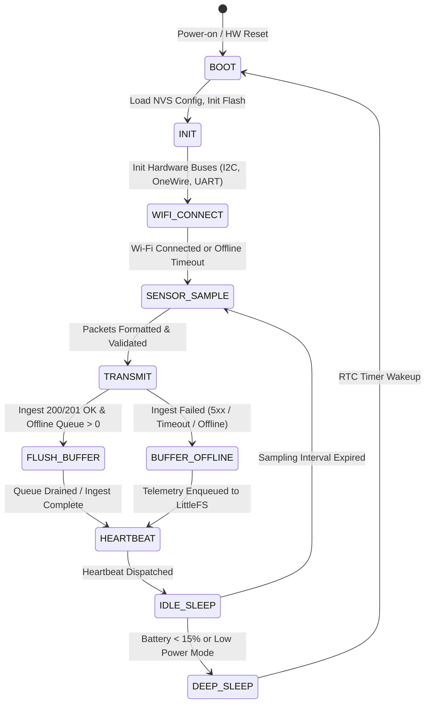
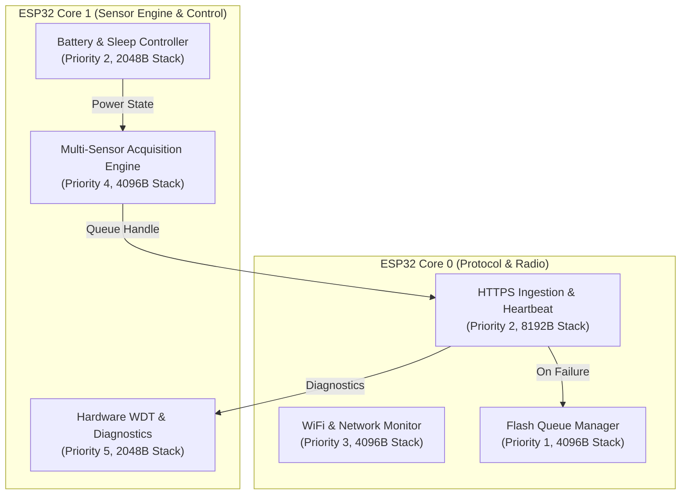

# AgriSense IoT Firmware — System Architecture Document

**Version**: `2.0.0`  
**Classification**: Embedded Firmware Specification  
**Architecture Pattern**: Event-Driven Multi-State Machine with Cooperative RTOS Scheduling  

---

## 1. System Overview & Design Philosophy

The AgriSense IoT firmware runs on an ESP32-WROOM-32 microcontroller within the ESP32 DevKit V1 board. It serves as the physical edge node in the AgriN platform, transforming physical soil conditions into cryptographically authenticated, range-validated, and temperature-compensated telemetry.

### Core Architectural Principles
1. **Zero-Crash Resilience**: No single peripheral failure, sensor disconnection, bus lockup, or network timeout may ever cause a microcontroller panic or fatal crash.
2. **Strict Data Provenance**: Field measurements are strictly tagged as `SENSOR_MEASURED`. Simulated or synthetic data is tagged as `SYNTHETIC`. Measurement quality is tracked across 6 discrete confidence levels (`GOOD`, `DEGRADED`, `CALIBRATION_EXPIRED`, `OUT_OF_RANGE`, `SENSOR_OFFLINE`, `INVALID`).
3. **Decoupled Sampling and Transmission**: Sensor acquisition runs independently of Wi-Fi or cellular availability. If network connectivity drops, telemetry packets are buffered in a persistent non-volatile flash FIFO queue.
4. **Non-blocking FreeRTOS Architecture**: Network I/O and TLS handshakes never starve critical hardware watchdogs or interrupt periodic sensor sampling.
5. **Strict 3.3V Electrical Compliance**: All analog probes interface via an external 16-bit ADC (ADS1115) powered at 3.3V, ensuring ESP32 GPIOs never receive out-of-spec 5V signals.

---

## 2. Finite State Machine (FSM)

The core lifecycle is governed by `DeviceManager` implementing an explicit 8-state finite state machine:

### State Definitions
1. **BOOT**: Power-on initialization. Reads hardware reset reason (`esp_reset_reason()`), configures hardware watchdog timers (WDT), and sets up serial debugging.
2. **INIT**: Mounts LittleFS file system and reads NVS persistent storage (device ID, API key, Wi-Fi SSID/password, calibration constants). If NVS is empty, loads compiled default parameters. Initializes I2C (Wire), OneWire, and Serial2 RS485.
3. **WIFI_CONNECT**: Initiates connection to configured WPA2/WPA3 access point with an exponential backoff timer (up to 15 seconds). If connection times out, transitions immediately to `SENSOR_SAMPLE` without blocking.
4. **SENSOR_SAMPLE**: Iterates through registered sensor drivers (`SensorManager`). Obtains soil temperature first, feeds temperature into pH and EC compensation equations, collects all analog channels from ADS1115, reads RS485 Modbus registers, and performs battery ADC check.
5. **TRANSMIT**: Serializes collected measurements into a canonical JSON telemetry payload matching AgriN's `/api/telemetry/ingest` contract. Sends HTTP POST with `X-Device-ID` and `X-API-Key` headers.
6. **FLUSH_BUFFER**: If active transmission succeeds and offline queue contains unsent packets, drains buffered packets sequentially with rate-limiting backoff.
7. **BUFFER_OFFLINE**: If Wi-Fi is disconnected or server returns 5xx/408/connection refused, serializes the packet and appends it to `storage/telemetry_buffer` on LittleFS.
8. **HEARTBEAT**: Transmits lightweight diagnostic heartbeat (`DeviceDiagnostics`) to `/api/devices/{id}/heartbeat` reporting battery voltage, RSSI, heap memory, and sensor status flags.
9. **IDLE_SLEEP / DEEP_SLEEP**: Delays between sampling cycles. If battery percentage falls below critical threshold (15%), puts system into ESP32 deep sleep, disabling RF and waking via RTC timer.

---

## 3. Memory Layout & Resource Budget

The firmware runs comfortably within the ESP32-WROOM-32 specifications (520 KB SRAM, 4 MB Flash):

| Memory Region | Allocated Size | Typical Usage | Description |
| :--- | :--- | :--- | :--- |
| **Flash (app0)** | 1.9 MB | ~850 KB (44%) | Application binary (Arduino, FreeRTOS, mbedTLS, ArduinoJson) |
| **Flash (LittleFS)** | 1.0 MB | ~250 KB (25%) | Ring buffer storage (up to 500 packets @ 512 bytes each) |
| **Flash (NVS)** | 20 KB | ~4 KB (20%) | Hardware IDs, API keys, Wi-Fi credentials, calibration offsets |
| **SRAM (Static)** | 120 KB | ~45 KB (37%) | Static variables, FreeRTOS kernel data structures |
| **SRAM (Free Heap)** | ~280 KB | >200 KB available | Dynamic memory for JSON parsing, HTTP client, TLS buffers |

---

## 4. FreeRTOS Task Management & Concurrency

When running in full multi-task mode, tasks are pinned to ESP32 dual cores to ensure zero interference between RF communications and precision analog timings:

---

## 5. Failover, Watchdogs, and Self-Healing

1. **Hardware Watchdog Timer (WDT)**:
   - Configured for a 30-second timeout on Core 1.
   - Pinned to the main loop; any frozen driver or infinite loop triggers an automatic hardware reset.
2. **I2C Bus Lockup Recovery**:
   - If ADS1115 fails to respond or holds the SDA line low, the driver generates 9 clock pulses on SCL (I2C bus clear sequence) followed by a STOP condition before reinitializing Wire.
3. **OneWire Bus Guard**:
   - DallasTemperature library calls are time-bounded; missing pull-up resistors or grounded data lines are caught immediately via CRC validation and -127°C return codes, preventing infinite wait loops.
4. **RS485 Serial Timeout**:
   - MAX3485 UART read operations use strict 200 ms timeout per Modbus query; missing NPK sensors return `UNAVAILABLE` without delaying other telemetry channels.
5. **Brownout Detector**:
   - ESP32 brownout detector is enabled at 2.8V to prevent flash corruption when the Li-ion battery is depleted.
