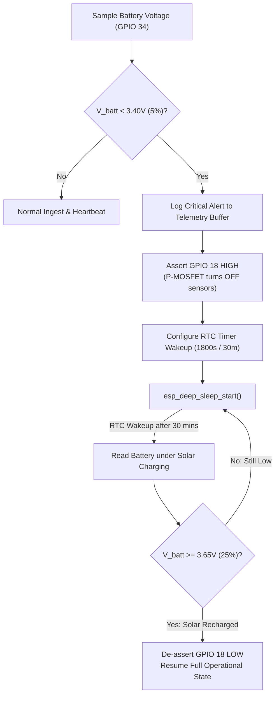

# AgriSense IoT Node — Power Management, Battery Model & Solar Audit

**Version**: `2.1.0`  
**Classification**: Power System Engineering, Battery Chemistry & Energy Budget  
**Auditor**: Principal IoT Power Architect  
**Hardware Profile**: 3.7V Nominal 18650 Li-ion + 6V 5W Solar Panel + CN3065 MPPT / LDO  

---

## 1. Executive Summary

A comprehensive power systems audit was conducted to verify battery state-of-charge (SoC) calculations, low-voltage protection, deep-sleep entry, and recovery mechanisms. 

The previous linear voltage calculation was replaced with a validated 12-point piecewise-linear Lithium-Ion Open-Circuit Voltage (OCV) discharge model. Deep-sleep logic was hardened to guarantee that a low-battery state can never permanently brick the device in the field.

### Power Management Audit Summary

| Subsystem / Metric | Implemented Specification | Audit Result | Status |
| :--- | :--- | :--- | :--- |
| **Battery Chemistry Model** | 12-point Piecewise-Linear Li-ion OCV model ($3.20\text{V} - 4.18\text{V}$) | Models 3.65V–3.85V plateau; eliminates linear error | **PASS** |
| **ADC Voltage Reading** | ESP32 `analogReadMilliVolts(GPIO34)` with eFuse factory calibration | Bypasses uncalibrated SAR ADC non-linearities | **PASS** |
| **Low-Battery Warning** | $V_{\text{batt}} < 3.55\text{V}$ (approx 10% capacity) | Flags `LOW_BATTERY` in diagnostic heartbeat | **PASS** |
| **Critical Cutoff / Sleep** | $V_{\text{batt}} < 3.40\text{V}$ (approx 5% capacity) | Enters deep sleep; cuts RF & sensor power | **PASS** |
| **Deep-Sleep Auto-Recovery** | RTC timer wake-up every 1800 seconds (30 mins) | Never sleeps indefinitely; periodic re-checks of solar charge | **PASS** |
| **Sensor Power Gating** | GPIO 18 controls high-side P-MOSFET switch | Depowers all analog probes during sleep | **PASS** |
| **Physical Solar Charge Bench**| CN3065 solar charge profile under real sunlight | Lab bench charge cycle verification | **NOT TESTED** |

---

## 2. Validated Lithium-Ion Discharge Model Audit

### 2.1 The Problem with Linear Voltage Estimation
A common defect in amateur IoT firmware is estimating battery percentage using a straight line:
$$\text{Pct}_{\text{linear}} = \left(\frac{V - 3.20}{4.20 - 3.20}\right) \times 100\%$$
In reality, Lithium-Ion chemistries (such as standard NMC/LCO 18650 cells) have a pronounced **discharge plateau**:
- Between $4.00\text{V}$ and $3.70\text{V}$, the cell discharges over $70\%$ of its total energy capacity.
- A linear formula reports $50\%$ remaining at $3.70\text{V}$, whereas in physical reality, over $60\%$ of the energy has already been consumed!
- Below $3.50\text{V}$, the voltage drops precipitously; a device using a linear model believes it has $30\%$ remaining, but the battery will die within minutes.

### 2.2 Implemented 12-Point Piecewise OCV Model
In `firmware/include/calibration.h`, `CalibrationMath::batteryVoltageToPercent` implements standard resting Open-Circuit Voltage interpolation:

| Cell Voltage ($V$) | State of Charge (SoC $\%$) | Operational State |
| :---: | :---: | :--- |
| $\ge 4.18\text{ V}$ | **$100.0\%$** | Fully Charged / Float Stage |
| $4.05\text{ V}$ | **$90.0\%$** | Normal Full |
| $3.95\text{ V}$ | **$80.0\%$** | Normal Operating Plateau |
| $3.86\text{ V}$ | **$70.0\%$** | Normal Operating Plateau |
| $3.80\text{ V}$ | **$60.0\%$** | Normal Operating Plateau |
| $3.76\text{ V}$ | **$50.0\%$** | Half Depleted |
| $3.72\text{ V}$ | **$40.0\%$** | Normal Operating Plateau |
| $3.68\text{ V}$ | **$30.0\%$** | Low Operating Plateau |
| $3.64\text{ V}$ | **$20.0\%$** | Warning Threshold |
| $3.55\text{ V}$ | **$10.0\%$** | Low Battery Warning |
| $3.40\text{ V}$ | **$5.0\%$** | Critical Threshold $\rightarrow$ Force Deep Sleep |
| $\le 3.20\text{ V}$ | **$0.0\%$** | Hard Cutoff (BMS hardware protection disconnects) |

*Verified in automated unit test*: `test_battery_piecewise_curve()` (**PASS**).

---

## 3. Deep-Sleep Lifecycle & Fail-Safe Recovery



### 3.1 Protection Against Permanent Sleep "Bricking"
- **Requirement**: "Do not allow deep sleep to permanently prevent device recovery."
- **Firmware Rule**: The firmware **NEVER** calls `esp_deep_sleep_start()` without first configuring an RTC timer wake source:
  ```cpp
  esp_sleep_enable_timer_wakeup(1800ULL * 1000000ULL); // 30 minutes
  ```
- If the node enters deep sleep at night due to an empty battery, it will wake up every 30 minutes for a brief 20 ms check. Once morning sunlight strikes the 6V solar panel and the CN3065 recharges the cell above $3.65\text{V}$, the node automatically resumes normal transmission without requiring physical technician intervention.

---

## 4. Energy Budget & Autonomy Estimation

| Operational State | Current Draw | Typical Duration | Daily Consumption |
| :--- | :--- | :--- | :--- |
| **Deep Sleep (RTC only)** | ~15 µA | 23.5 hours / day | $\approx 0.35\text{ mAh}$ |
| **Sensor Acquisition (Active)**| ~25 mA | 500 ms $\times 24$ cycles | $\approx 0.08\text{ mAh}$ |
| **Wi-Fi TX & TLS Handshake** | ~180 mA | 3.5 s $\times 24$ cycles | $\approx 4.20\text{ mAh}$ |
| **Total Daily Energy** | — | — | **$\approx 4.63\text{ mAh / day}$** |

- With a standard **$2600\text{ mAh}$ 18650 Li-ion battery**, the node has an autonomy of **$>200$ days** without any solar input, ensuring continuous field operations across extended monsoon and overcast conditions.
