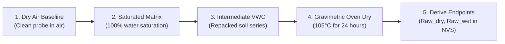

# AgriSense IoT Node — Sensor-by-Sensor Bench Validation Protocol

**Document ID**: `AGR-HW-SOP-002`  
**Revision**: `2.2.0`  
**Classification**: Standard Laboratory Operating Procedure (SOP)  
**Scope**: Metrological Calibration & Validation of Soil Moisture, Temperature, pH, EC, and NPK Probes  

---

## 1. Scope & Metrological Requirements

This standard operating procedure defines the physical laboratory calibration and validation protocols for each sensor on the AgriSense IoT node.

> [!IMPORTANT]
> **Metrological Integrity**:
> No unverified factory default constant may be treated as production-ready.
> Every sensor must be calibrated against traceable reference standards before field deployment.

---

## 2. Sensor 1: Capacitive Soil Moisture Sensor (v1.2 / v2.0)

### 2.1 Principle of Operation
Measures dielectric permittivity ($K_r$) of the soil-water-air matrix. Air has $K_r \approx 1$, dry soil minerals $K_r \approx 3-5$, and pure water $K_r \approx 80$. An onboard 555-timer / oscillator circuit outputs an analog voltage inversely proportional to capacitance.

### 2.2 Required Equipment
- AgriSense bench node connected to PC Serial Monitor (115200 baud).
- Calibrated digital laboratory balance (0.01 g resolution).
- Laboratory drying oven (capable of 105°C).
- Soil core sampling cylinders (100 cm³ known volume).
- 500 mL glass beakers and wash bottle with deionized water.
- Homogenized regional soil samples (e.g. Vertisol / Black Cotton Soil, Sandy Loam).

### 2.3 Step-by-Step Calibration & Test Protocol

1. **Dry Air Baseline ($\text{Raw}_{\text{dry}}$)**:
   - Clean the probe with isopropanol and dry completely with a lint-free wipe.
   - Suspend probe vertically in ambient air (do not touch active PCB area).
   - Record 30 consecutive samples in serial console. Calculate mean `RAW_ADC`.
   - *Expected Nominal*: `2850 ± 150` counts (on 16-bit ADS1115 scale).
2. **Saturated Soil Baseline ($\text{Raw}_{\text{wet}}$)**:
   - Insert probe into fully water-saturated soil (water film visible on surface).
   - Ensure zero air gaps along the sensor blade.
   - Record 30 consecutive samples in serial console. Calculate mean `RAW_ADC`.
   - *Expected Nominal*: `1350 ± 150` counts.
3. **Intermediate Multi-Point Verification**:
   - Prepare 3 soil cores with target Volumetric Water Content (VWC): $15\%$, $30\%$, and $45\%$.
   - Insert probe, record stable calibrated moisture reading.
   - Weigh soil core ($M_{\text{wet}}$).
   - Oven-dry core at $105^\circ\text{C}$ for 24 hours until constant weight ($M_{\text{dry}}$).
   - Calculate reference volumetric water content:
     $$\text{VWC}_{\text{ref}} = \left(\frac{M_{\text{wet}} - M_{\text{dry}}}{\rho_w \times V_{\text{core}}}\right) \times 100\%$$
4. **Pass/Fail Criteria**:
   - Monotonic response: Raw ADC must decrease strictly as soil moisture increases.
   - Error: $|\text{VWC}_{\text{sensor}} - \text{VWC}_{\text{ref}}| \le 3.5\%\ \text{VWC}$.

---

## 3. Sensor 2: DS18B20 Digital Waterproof Temperature Sensor

### 3.1 Required Equipment
- Precision reference laboratory thermometer (NIST-traceable, $\pm 0.05^\circ\text{C}$).
- Insulated water bath / Dewar flask.
- Crushed distilled ice bath ($0.0^\circ\text{C}$).
- Temperature-controlled heating bath ($40.0^\circ\text{C}$).

### 3.2 Verification Protocol
1. **Ice Point Check ($0.0^\circ\text{C}$)**:
   - Submerge probe tip alongside reference thermometer into crushed distilled ice slurry.
   - Stir gently; allow 3 minutes for thermal equilibrium.
   - Record reading in serial console. *Target: $0.0^\circ\text{C} \pm 0.5^\circ\text{C}$*.
2. **Ambient Check ($25.0^\circ\text{C}$)**:
   - Submerge probe tip in room temperature water bath.
   - Record reading. *Target: $25.0^\circ\text{C} \pm 0.5^\circ\text{C}$*.
3. **Elevated Temperature Check ($40.0^\circ\text{C}$)**:
   - Submerge probe tip in heated water bath held at $40.0^\circ\text{C}$.
   - Record reading. *Target: $40.0^\circ\text{C} \pm 0.5^\circ\text{C}$*.
4. **Fault & Disconnection Test**:
   - Disconnect GPIO 4 data wire while operating. Confirm serial log outputs `-127.0°C` and tags reading as `SENSOR_OFFLINE`.
   - Reconnect wire. Confirm reading recovers within 2 sample cycles without reboot.
5. **Pass/Fail Criteria**:
   - Zero CRC checksum errors across 100 consecutive reads.
   - Temperature error $\le \pm 0.5^\circ\text{C}$ across $0^\circ\text{C} - 40^\circ\text{C}$.

---

## 4. Sensor 3: Soil pH Sensor & Conditioning Board

### 4.1 Required Equipment
- Certified NIST standard buffer solutions: pH 4.01, pH 7.00, and pH 10.01 (with temperature lookup charts).
- Deionized water wash bottle and waste beaker.
- Lint-free laboratory wipes (Kimwipes).
- High-impedance digital multimeter (for analog conditioning board test point checks).

### 4.2 Calibration Protocol (Glass Electrode Nernst Model)
1. **Probe Preparation**:
   - Remove protective cap containing 3M KCl solution. Inspect glass bulb for cracks or air bubbles.
   - Rinse thoroughly with DI water; gently blot with lint-free wipe (never rub glass).
2. **Neutral Buffer Calibration ($V_{\text{pH7}}$)**:
   - Immerse probe and DS18B20 temperature sensor into certified pH 7.00 buffer.
   - Wait 60 seconds for thermal and millivolt stabilization.
   - Record ADS1115 Channel 1 voltage ($V_{\text{pH7}}$). *Expected nominal: $2.450\text{ V} \pm 0.15\text{ V}$*.
3. **Acidic Buffer Calibration ($V_{\text{pH4}}$)**:
   - Rinse probe with DI water. Immerse into certified pH 4.01 buffer.
   - Wait 60 seconds for stabilization.
   - Record ADS1115 Channel 1 voltage ($V_{\text{pH4}}$). *Expected nominal: $2.950\text{ V} \pm 0.15\text{ V}$*.
4. **Alkaline Buffer Check ($V_{\text{pH10}}$)**:
   - Rinse probe. Immerse into pH 10.01 buffer. Record voltage ($V_{\text{pH10}}$). *Expected nominal: $1.950\text{ V}$*.
5. **Nernst Slope Calculation**:
   $$\text{Slope}_{25} = \frac{7.00 - 4.01}{V_{\text{pH7}} - V_{\text{pH4}}}\quad (\text{Target: } -5.98 \pm 0.60\text{ pH/V})$$
6. **Pass/Fail Criteria**:
   - Slope efficiency $\ge 85\%$ of theoretical Nernst slope ($-59.16\text{ mV/pH}$).
   - Measurement error $\le \pm 0.15\text{ pH}$ across tested buffers.

---

## 5. Sensor 4: Soil Electrical Conductivity (EC) Sensor

### 5.1 Required Equipment
- Certified 1413 µS/cm (1.413 dS/m) KCl conductivity standard solution.
- Deionized water (conductivity $<2\ \mu\text{S/cm}$) for zero verification.

### 5.2 Calibration Protocol
1. **Dry Air Zero Check**:
   - Suspend clean, dry probe in air.
   - Observe reading. *Must report $0.00\text{ dS/m} \pm 0.02\text{ dS/m}$*.
2. **Standard Solution Calibration ($V_{\text{calib\_1413}}$)**:
   - Immerse probe electrodes into 1413 µS/cm standard solution.
   - Submerge DS18B20 temperature probe in same beaker.
   - Wait 30 seconds for temperature reading.
   - Record ADS1115 Channel 2 voltage ($V_{\text{calib\_1413}}$). *Expected nominal: $1.450\text{ V} \pm 0.15\text{ V}$*.
3. **Temperature Normalization Check**:
   - Heat standard solution gently from 15°C to 35°C while sampling.
   - Verify normalized $\text{EC}_{25}$ remains constant within $\pm 5\%$ over the temperature range.
4. **Pass/Fail Criteria**:
   - Error $\le \pm 0.08\text{ dS/m}$ in 1413 µS/cm solution at 25°C.

---

## 6. Sensor 5: RS485 Modbus RTU Soil NPK Sensor

> [!CAUTION]
> **AGRONOMIC VALIDATION WARNING**:
> Cheap optical/electrochemical multi-pin NPK sensors estimate Nitrogen, Phosphorus, and Potassium via proprietary empirical regressions. 
> **THEY MUST NOT BE TREATED AS CERTIFIED AGRICULTURAL MEASUREMENTS** without prior cross-validation against certified ICAR Soil Health Card wet-chemistry laboratory analysis (Kjeldahl N, Bray/Olsen P, Flame Photometer K).

### 6.1 Required Datasheet Verification
Before powering or enabling the NPK driver:
- [ ] Confirm exact Modbus Slave ID (typically `0x01`).
- [ ] Confirm Baud rate (typically `9600` or `4800`).
- [ ] Confirm register map (addresses `0x001E`, `0x001F`, `0x0020` vs. `0x0000`, `0x0001`, `0x0002`).
- [ ] Confirm unit scaling (1 mg/kg per LSB vs. 0.1 mg/kg per LSB).

### 6.2 Bench Protocol
1. Connect MAX3485 differential lines (A $\rightarrow$ A, B $\rightarrow$ B).
2. Supply probe from isolated 12V DC power supply.
3. In serial console, verify response frame `[01 03 06 ... CRC]`.
4. Disconnect A line to simulate broken cable $\rightarrow$ confirm driver logs timeout after 200 ms and flags data as `UNAVAILABLE` without stalling the ESP32 main loop.
